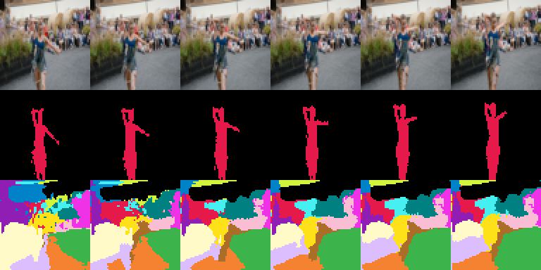
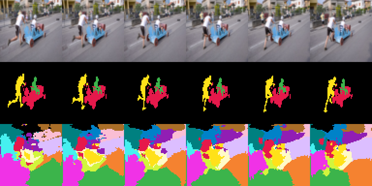

# Object-Centric Video Representation Learning with STEVE

This repository implements and evaluates **STEVE (Slot-Transformer for Eventual Video Representation)** across synthetic multi-object scenes (**MOVi-C**) and real-world video object segmentation (**DAVIS 2017**).

---

## Project Progress & Benchmark Results

| Phase | Dataset | Evaluation Setting | FG-ARI (%) | mBO (%) |
| :--- | :--- | :--- | :---: | :---: |
| **Phase 1** | MOVi-C (Synthetic) | In-Domain Validation | **39.67%** | — |
| **Phase 2** | DAVIS 2017 Val (Real-World) | Zero-Shot Transfer (from MOVi-C) | **9.54%** | **27.23%** |
| **Phase 2** | DAVIS 2017 Val (Real-World) | Fine-Tuned on DAVIS 2017 Train | **9.89%** | **28.36%** |

---

## Phase 1: Synthetic Baseline (MOVi-C)
- Trained STEVE (`num_slots=15`, `image_size=64`) on MOVi-C multi-object synthetic videos.
- Achieved **39.67% FG-ARI**, demonstrating clean object-level slot decomposition on uniform backgrounds.

---

## Phase 2: Real-World Evaluation & Fine-Tuning (DAVIS 2017)
- **Data Pipeline (`prepare_davis_data.py`):** Processed DAVIS 2017 TrainVal (480p) into 60 training sequences (`davis_train`) and 30 validation sequences (`davis_eval`) with per-instance binary masks.
- **Evaluation (`eval_davis.py`):** Implemented automated **FG-ARI** and **Mean Best Overlap (mBO)** evaluation across 6-frame video episodes.
- **Fine-Tuning (`finetune_davis.py`):** Fine-tuned the Phase 1 checkpoint (`phase1_best_model.pt`) on DAVIS 2017 train sequences, improving validation FG-ARI from **9.54% → 9.89%** and mBO from **27.23% → 28.36%**.

### Qualitative Results (DAVIS 2017 Validation)
*Top: Input RGB Frames | Middle: Ground-Truth Instance Masks | Bottom: STEVE Predicted Slot Masks*

| Sample 1 | Sample 2 |
| :---: | :---: |
|  |  |

| Sample 3 | Sample 4 |
| :---: | :---: |
|  |  |

### Key Findings (Synthetic-to-Real Domain Gap)
- **Temporal Tracking:** Slots maintain consistent object identity across consecutive frames.
- **Texture Over-Segmentation:** Purely RGB reconstruction-driven slot attention partitions complex real-world backgrounds (foliage, crowds, shadows) into multiple slots, motivating **developmental/motion-based inductive biases in Phase 3**.

---

## Repository Structure
- `steve.py`, `dvae.py`, `transformer.py`, `utils.py`, `ari.py`, `data.py`: Core STEVE model architecture and dataset loaders.
- `prepare_movi_data.py`, `train.py`, `eval_fgari_video.py`: Phase 1 MOVi-C pipeline.
- `prepare_davis_data.py`, `finetune_davis.py`, `eval_davis.py`, `visualize_davis.py`: Phase 2 DAVIS 2017 pipeline.
- `results/phase2/`: Qualitative segmentation visualizations on DAVIS 2017 validation sequences.
