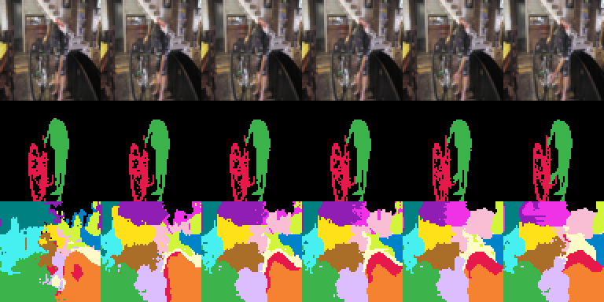
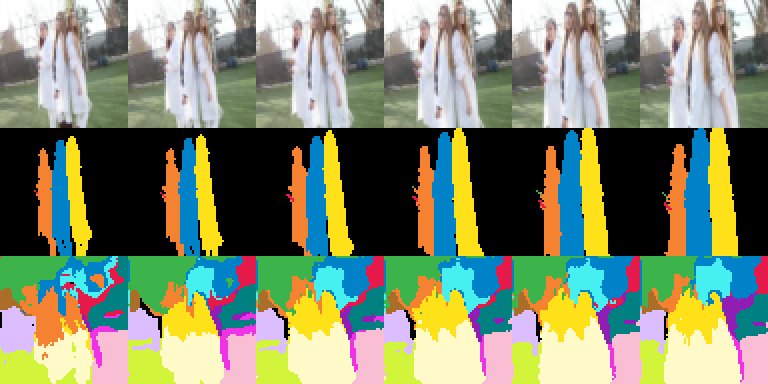

# Object-Centric Video Representation Learning with STEVE

A comprehensive study and implementation of **STEVE (Slot-Transformer for Eventual Video Representation)** investigating object-centric scene decomposition, temporal tracking, and the **Synthetic-to-Real Domain Gap** across controlled synthetic multi-object videos (**MOVi-C**) and complex real-world video object segmentation benchmarks (**DAVIS 2017**).

---

## Table of Contents
1. [Project Overview & Research Motivation](#1-project-overview--research-motivation)
2. [Model Architecture Summary](#2-model-architecture-summary)
3. [Overall Benchmark Results](#3-overall-benchmark-results)
4. [Phase 1: Synthetic Baseline & In-Domain Evaluation (MOVi-C)](#4-phase-1-synthetic-baseline--in-domain-evaluation-movi-c)
5. [Phase 2: Real-World Evaluation & Domain Adaptation (DAVIS 2017)](#5-phase-2-real-world-evaluation--domain-adaptation-davis-2017)
6. [Qualitative Visualization & Error Analysis](#6-qualitative-visualization--error-analysis)
7. [Repository File Structure & Code Documentation](#7-repository-file-structure--code-documentation)
8. [Environment Setup & Step-by-Step Replication Guide](#8-environment-setup--step-by-step-replication-guide)

---

## 1. Project Overview & Research Motivation

Unsupervised object-centric learning aims to decompose raw visual scenes into discrete, reusable object representations ("slots") without pixel-level human annotations. While architectures like **STEVE** perform strongly on synthetic datasets with uniform backgrounds, deploying them directly onto unconstrained real-world video remains a major challenge.

This repository tracks our systematic progression across two completed phases:
- **Phase 1:** Establishing a clean synthetic multi-object baseline on **MOVi-C** to validate slot attention decomposition and autoregressive transformer dynamics.
- **Phase 2:** Evaluating **Zero-Shot Synthetic-to-Real Transfer** and **Supervised/Self-Supervised Domain Fine-Tuning** on **DAVIS 2017**, measuring both clustering accuracy (**FG-ARI**) and boundary overlap (**mBO**), and diagnosing texture over-segmentation to motivate developmental/motion inductive biases in **Phase 3**.

---

## 2. Model Architecture Summary

STEVE combines three core neural components trained end-to-end via discrete token reconstruction:
1. **Discrete Variational Autoencoder (`dvae.py`):** Compresses input RGB video frames ($64 \times 64 \times 3$) into discrete visual token grids using Gumbel-Softmax relaxation (`vocab_size = 4096`).
2. **Recurrent Slot Attention Encoder (`steve.py`):** Iteratively binds spatial CNN features into $K = 15$ competing object slots (`slot_size = 192`) at each timestep and propagates slot states temporally via a Transformer predictor (`num_predictor_blocks = 1`, `num_predictor_heads = 4`).
3. **Autoregressive Slot-Transformer Decoder (`transformer.py`):** Reconstructs discrete dVAE image tokens conditioned on the extracted object slots (`num_decoder_blocks = 8`, `num_decoder_heads = 4`, `d_model = 192`), forcing slots to specialize in distinct objects.

---

## 3. Overall Benchmark Results

| Phase | Dataset | Evaluation Protocol | FG-ARI (%) | mBO (%) | Key Takeaway |
| :--- | :--- | :--- | :---: | :---: | :--- |
| **Phase 1** | MOVi-C Val (Synthetic) | In-Domain Validation | **39.67%** | — | Strong object-level separation on clean synthetic textures |
| **Phase 2** | DAVIS 2017 Val (Real-World) | Zero-Shot Transfer (from MOVi-C) | **9.54%** | **27.23%** | Severe domain drop due to complex real-world background clutter |
| **Phase 2** | DAVIS 2017 Val (Real-World) | Fine-Tuned on DAVIS 2017 Train | **9.89%** | **28.36%** | Consistent gains across both metrics after domain adaptation |

---

## 4. Phase 1: Synthetic Baseline & In-Domain Evaluation (MOVi-C)

### Objective & Methodology
Phase 1 validates the core STEVE pipeline on **MOVi-C**, a synthetic multi-object dataset containing rigid 3D objects moving with realistic physics over relatively uniform backgrounds.
- **Data Preprocessing (`prepare_movi_data.py`):** Converts raw MOVi-C episodes into standardized $64 \times 64$ RGB frame sequences and ground-truth instance segmentation masks.
- **Training (`train.py`):** Trained STEVE from scratch using combined MSE reconstruction loss and cross-entropy discrete token prediction loss, with linear learning rate warmup (`30,000` steps) and cosine Gumbel-Softmax temperature annealing ($\tau: 1.0 \rightarrow 0.1$).
- **Evaluation (`eval_fgari_video.py`):** Computed **Foreground Adjusted Rand Index (FG-ARI)** across multi-frame video episodes (`ep_len = 6`), excluding background pixels to strictly measure foreground object discovery and temporal identity consistency.

### Phase 1 Training Configuration

| Hyperparameter | Value | Description |
| :--- | :---: | :--- |
| `image_size` | `64` | Input frame spatial resolution ($64 \times 64$) |
| `num_slots` | `15` | Maximum number of competing object slots |
| `num_iterations` | `2` | Slot Attention refinement iterations per frame |
| `ep_len` | `3` (train) / `6` (eval) | Temporal sequence length per clip |
| `batch_size` | `24` | Training mini-batch size |
| `lr_dvae` / `lr_enc` / `lr_dec` | `3e-4` / `1e-4` / `3e-4` | Component-specific Adam learning rates |
| `lr_warmup_steps` | `30,000` | Linear warmup steps for encoder & decoder |
| `tau_start` → `tau_final` | `1.0` → `0.1` | Gumbel-Softmax temperature schedule (`30,000` steps) |
| `clip` | `0.05` | Gradient norm clipping threshold |

### Phase 1 Outcome
- Achieved **39.67% FG-ARI** on MOVi-C validation videos (`phase1_best_model.pt`), confirming that slots cleanly isolate individual foreground objects and maintain consistent slot assignments across frames.

---

## 5. Phase 2: Real-World Evaluation & Domain Adaptation (DAVIS 2017)

### Objective & Methodology
Phase 2 tests how well object representations learned on synthetic data generalize to unconstrained real-world videos (**DAVIS 2017 TrainVal 480p**) containing articulated human/animal motion, camera movement, motion blur, and rich background textures.

1. **Dataset Pipeline (`prepare_davis_data.py`):**
   - Resized DAVIS 2017 480p sequences to $64 \times 64$ resolution following the official dataset split: **60 training videos** (`davis_train`, yielding `1,380` 3-frame training episodes) and **30 validation videos** (`davis_eval`, yielding `657` validation episodes).
   - Decomposed indexed ground-truth annotations into per-instance binary masks (`00000000_mask_00.png`, etc.) compatible with STEVE's mask evaluation loader.
2. **Dual-Metric Evaluation (`eval_davis.py`):**
   - **FG-ARI (Foreground Adjusted Rand Index):** Measures pixel-wise clustering agreement across all foreground instances over 6-frame clips.
   - **mBO (Mean Best Overlap / IoU):** For every ground-truth foreground object mask, computes the highest Intersection-over-Union (IoU) achieved by any predicted slot mask and averages across all instances.
3. **Zero-Shot Transfer Evaluation:**
   - Evaluated the Phase 1 MOVi-C checkpoint (`phase1_best_model.pt`) directly on DAVIS 2017 validation videos without any fine-tuning, obtaining **9.54% FG-ARI** and **27.23% mBO**.
4. **Domain Fine-Tuning (`finetune_davis.py`):**
   - Initialized STEVE with `phase1_best_model.pt` and fine-tuned on the 60 DAVIS 2017 training sequences for **25 epochs** using reduced learning rates and shortened warmup/annealing schedules to prevent catastrophic forgetting.
   - Validation loss decreased from `604.06` (Epoch 1) to a minimum of **`588.66` at Epoch 7** (`logs_phase2/best_model_davis.pt`), improving validation **FG-ARI to 9.89%** (`+0.35%`) and **mBO to 28.36%** (`+1.13%`).

### Phase 2 Fine-Tuning Configuration

| Hyperparameter | Value | Description |
| :--- | :---: | :--- |
| `pretrained_weights` | `phase1_best_model.pt` | Initialized from Phase 1 MOVi-C checkpoint |
| `train_split` / `val_split` | `60` videos / `30` videos | Official DAVIS 2017 TrainVal split (`1,380` / `657` clips) |
| `image_size` | `64` | Input frame resolution ($64 \times 64$) |
| `num_slots` | `15` | Number of object slots |
| `ep_len` | `3` (train) / `6` (eval) | Temporal clip length |
| `batch_size` | `16` | Fine-tuning batch size |
| `lr_dvae` / `lr_enc` / `lr_dec` | `1e-4` / `5e-5` / `1e-4` | Lowered learning rates for stable adaptation |
| `lr_warmup_steps` | `500` | Short warmup adapted for pre-trained weights |
| `tau_start` → `tau_final` | `0.5` → `0.1` | Cosine temperature annealing over `3,000` steps |
| `epochs` | `25` | Total fine-tuning epochs (best checkpoint saved @ Epoch 7) |

---

## 6. Qualitative Visualization & Error Analysis

Generated via `visualize_davis.py` across 6-frame validation clips from DAVIS 2017:
- **Top Row:** Original RGB input frames ($64 \times 64$, upscaled $2\times$ for display).
- **Middle Row:** Ground-truth foreground instance segmentation masks.
- **Bottom Row:** Hard slot assignments ($\arg\max_k \text{mask}_k$) predicted by fine-tuned STEVE across 15 slots.

| Sample 1 (Bmx-Trees) | Sample 2 (Breakdance) |
| :---: | :---: |
|  |  |

| Sample 3 (Dance-Twirl) | Sample 4 (Soapbox) |
| :---: | :---: |
|  |  |

### Diagnostic Findings (Motivating Phase 3)
1. **Consistent Temporal Identity Tracking:** Across all 6 frames in each episode, individual slots reliably track the same spatial regions over time (e.g., the yellow/orange foreground slots in Samples 3 and 4).
2. **Background Texture Over-Segmentation:** Because STEVE optimizes purely pixel-level RGB token reconstruction without semantic or motion priors, high-frequency real-world backgrounds (foliage, crowds, pavement shadows) consume the majority of the 15 slots.
3. **Part-Level Fragmentation:** Large articulated foreground subjects (cyclists, dancers) are frequently split into multiple color-/texture-homogeneous sub-parts rather than unified whole-object masks—directly motivating **developmental and motion-based inductive biases in Phase 3**.

---

## 7. Repository File Structure & Code Documentation

### Core Model & Data Modules
| File | Purpose & Functionality |
| :--- | :--- |
| `steve.py` | Implements the full `STEVE` architecture, combining the CNN backbone, recurrent Slot Attention encoder, Transformer temporal predictor, and autoregressive token decoder. |
| `dvae.py` | Implements the Discrete Variational Autoencoder (`dVAE`) encoder/decoder with Gumbel-Softmax discrete visual tokenization. |
| `transformer.py` | Implements causal/autoregressive Transformer decoder blocks and multi-head attention layers used for token generation and slot prediction. |
| `utils.py` | Utility functions for learning rate warmup (`linear_warmup`), cosine annealing (`cosine_anneal`), and weight initialization. |
| `data.py` | PyTorch `Dataset` classes (`GlobVideoDataset`, `GlobVideoDatasetWithMasks`) for loading sequential RGB frames and multi-instance binary masks. |
| `ari.py` | Vectorized implementation of Adjusted Rand Index (`evaluate_ari`) for evaluating instance segmentation masks across video frames. |

### Phase 1 Scripts (MOVi-C)
| File | Purpose & Functionality |
| :--- | :--- |
| `prepare_movi_data.py` | Downloads and extracts MOVi-C video frames and instance masks into episode directories. |
| `download_movi.py` / `download_movi_with_masks.py` | Helper scripts for fetching MOVi-C dataset shards. |
| `train.py` | Main training loop for pre-training STEVE from scratch with TensorBoard logging and checkpointing. |
| `eval_fgari_video.py` | Evaluates a trained STEVE checkpoint on MOVi-C validation clips using FG-ARI. |

### Phase 2 Scripts & Artifacts (DAVIS 2017)
| File | Purpose & Functionality |
| :--- | :--- |
| `prepare_davis_data.py` | Preprocesses DAVIS 2017 TrainVal (480p) into 60 training sequences (`davis_train`) and 30 validation sequences (`davis_eval`) with per-object binary masks. |
| `eval_davis.py` | Evaluates any STEVE checkpoint on DAVIS 2017 validation videos and reports both **FG-ARI (%)** and **Mean Best Overlap / mBO (%)**. |
| `finetune_davis.py` | Loads the Phase 1 checkpoint (`phase1_best_model.pt`), fine-tunes STEVE on DAVIS 2017 training sequences, and saves the best validation checkpoint (`logs_phase2/best_model_davis.pt`). |
| `visualize_davis.py` | Generates qualitative 3-row comparison grids (RGB Input, Ground-Truth Masks, Predicted Slot Masks) on DAVIS 2017 validation episodes. |
| `davis_sample_1.png` – `davis_sample_4.png` | Qualitative segmentation grids generated by the fine-tuned Phase 2 model. |

---

## 8. Environment Setup & Step-by-Step Replication Guide

### Step 1: Clone Repository & Install Dependencies
```bash
git clone [https://github.com/Chaami-Hewage/Phase-2.git](https://github.com/Chaami-Hewage/Phase-2.git)
cd Phase-2
pip install torch torchvision numpy pillow matplotlib tqdm scikit-learn
